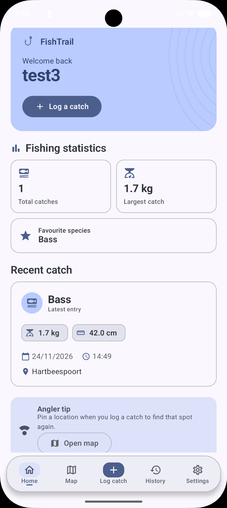
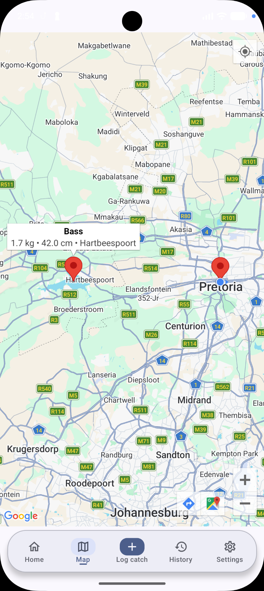
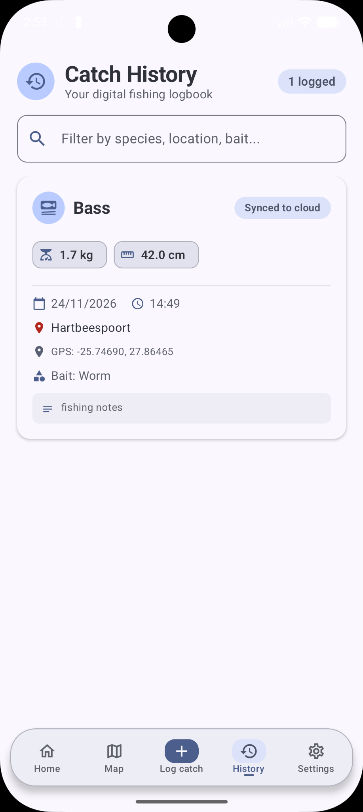
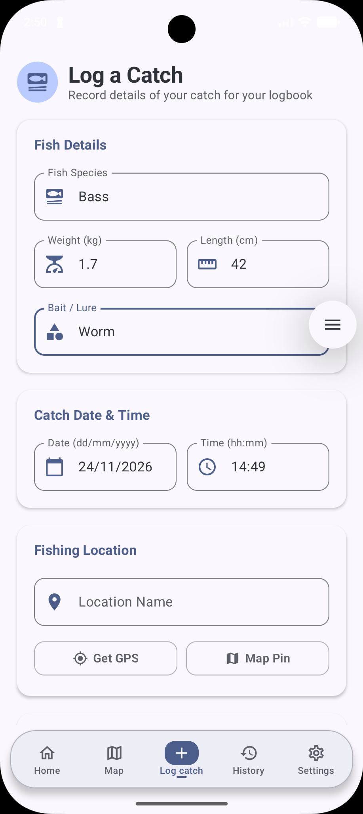
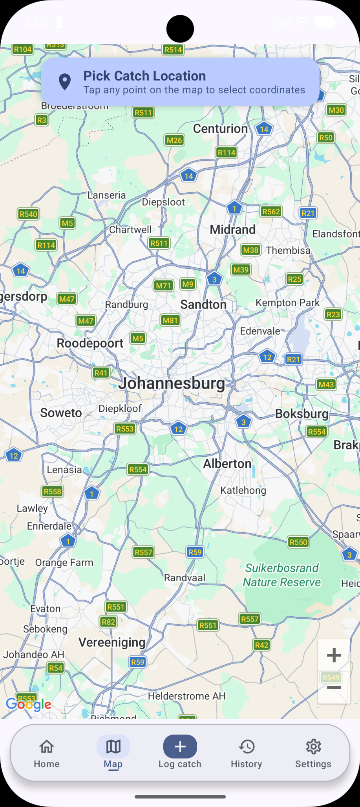
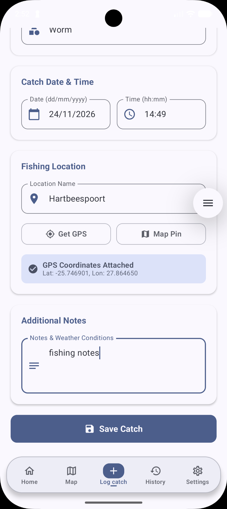

# FishTrail

FishTrail is a native Android fishing logbook for anglers who want to remember what they caught, which bait worked and where to cast again. Log a catch at the water, keep it on the device and revisit the spot on Google Maps.

**Kotlin · Jetpack Compose · Room · Firebase · Google Maps**

## A catch at Hartbeespoort

A 1.7 kg bass caught on a worm becomes the angler’s largest catch. Tap its map pin to see the measurements, or open the logbook to find the bait, notes and cloud sync status.

| Dashboard | Catch map | Catch history |
| :---: | :---: | :---: |
| <a href="docs/screenshots/dashboard.png"></a> | <a href="docs/screenshots/catch-map.png"></a> | <a href="docs/screenshots/catch-history.png"></a> |

<details>
<summary><strong>See how the angler recorded this catch</strong></summary>

From the [empty dashboard](docs/screenshots/dashboard-empty.png), choose **Log a catch**. Enter the measurements, then use the device’s GPS or pick a point on the map. The selected coordinates return to the form so the angler can add notes before saving.

| Record the catch | Choose a spot | Save the entry |
| :---: | :---: | :---: |
| <a href="docs/screenshots/catch-details.png"></a> | <a href="docs/screenshots/map-picker.png"></a> | <a href="docs/screenshots/catch-location.png"></a> |

</details>

## Inside the app

| Engineering choice | How FishTrail uses it |
| --- | --- |
| Room and Cloud Firestore | Room keeps catches available between trips, including offline. Pending catches can sync to the cloud, and History shows the sync status for each entry. |
| Google Maps and Android location services | The map serves two jobs. During entry it returns a selected point to the form. When browsing, its markers show catches at their recorded locations. |
| Jetpack Compose and Material 3 | The dashboard summarises total catches, largest catch and favourite species. History lets anglers filter individual entries by species, location or bait. |
| ViewModel and StateFlow | The catch ViewModel exposes the signed-in angler’s records as observable state for the UI. |
| Firebase Authentication | Anglers can register with email and password or sign in with Google to access their own logbook. |

**Explore the code** · [Catch entry](app/src/main/java/com/fishtrail/app/catchlog/) · [Map](app/src/main/java/com/fishtrail/app/map/) · [Data layer](app/src/main/java/com/fishtrail/app/data/) · [Authentication](app/src/main/java/com/fishtrail/app/auth/)

## Run locally

1. Clone the project and open the resulting folder in Android Studio.

   ```bash
   git clone https://github.com/CeejayAlughere/FishTrailApp.git
   cd FishTrailApp
   ```

2. Use JDK 21 for Gradle and install the Android SDK requested by the [app build configuration](app/build.gradle.kts).
3. For your own Firebase environment, register the Android app as `com.fishtrail.app`, enable Email/Password and Google sign-in, add your debug signing fingerprint, and configure Cloud Firestore. Place the matching `google-services.json` in `app/`.
4. Configure a Google Maps API key for the Maps SDK for Android using the key reference in the [Android manifest](app/src/main/AndroidManifest.xml).
5. Sync Gradle, select a device or emulator with Google Play services, and run the **app** configuration.

To run the debug unit tests and build the debug APK from the project root:

```bash
./gradlew :app:testDebugUnitTest :app:assembleDebug
```

## Developer

**Ceejay Chukwuebuka John Alughere** · [GitHub](https://github.com/CeejayAlughere) · [LinkedIn](https://www.linkedin.com/in/ceejay-alughere-02aa37414/)
